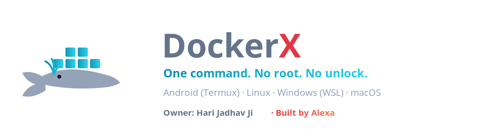
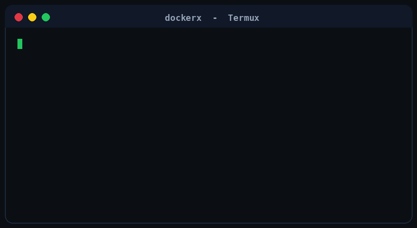
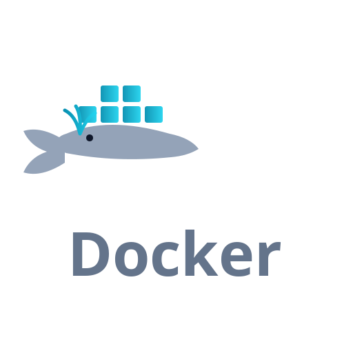

<div align="center">



# 🐳 DockerX — Install Docker on Android (Termux), Linux, Windows (WSL) & macOS

**One command. No root. No unlock. No headache.**


*Docker install karo ek hi command se — Termux, Ubuntu, Debian, Parrot OS, Kali, WSL, macOS sab me.*

</div>

---

## 🎬 Demo



---

## 📥 Platform-wise install (clone + run)

Har platform ke liye alag command — apne hisaab se chuno.
> `nullkrishn90` ko apne GitHub username se replace karo (repo ka naam `docker`).

### 📱 Android / Termux
```bash
pkg install git -y
git clone https://github.com/nullkrishn90/docker.git
cd docker
bash install.sh
```

### 🐧 Linux (Ubuntu / Debian / Parrot OS / Kali / Mint)
```bash
sudo apt-get update && sudo apt-get install -y git
git clone https://github.com/nullkrishn90/docker.git
cd docker
bash install.sh
```

### 🪟 Windows (WSL2 — recommended)
WSL2 kholo (Ubuntu), phir:
```bash
sudo apt-get update && sudo apt-get install -y git
git clone https://github.com/nullkrishn90/docker.git
cd docker
bash install.sh
```

### 🍎 macOS
```bash
git clone https://github.com/nullkrishn90/docker.git
cd docker
bash install.sh
```

### 🪟 Windows (native — no WSL)
Bash se Docker native install nahi hota. Do raste:
1. **Docker Desktop** install karo — https://www.docker.com/products/docker-desktop/
2. Ya **WSL2** kholo aur upar wala WSL command chalao.

### Sab platforms — install ke baad
```bash
dockerx start
```

---

## 📋 Requirements (kya chahiye)

### 📱 Android / Termux

| Cheez | Minimum | Recommended |
|---|---|---|
| **Android version** | 7.0 (Nougat) | 10+ |
| **RAM** | 2 GB | 4 GB+ |
| **Free storage** | 2 GB | 5 GB+ |
| **CPU** | arm64 / armv7 / x86_64 | **arm64 (aarch64)** |
| **App** | Termux (F-Droid) | Termux + latest packages |
| **Root** | **Zaroorat NAHI** | — |

> 32-bit (armv7) par bhi chalta hai, par thoda slow aur kuch images fail ho sakti hain.
> **arm64 sabse achha hai.**

### 🐧 Linux / 🪟 WSL

| Cheez | Requirement |
|---|---|
| Distro | apt-based (Ubuntu/Debian/Parrot/Kali/Mint) |
| Privilege | `sudo` (Docker install ke liye) |
| Storage | ~1 GB |

### 🍎 macOS
Docker Desktop install hona chahiye.

---

## 🔍 Ye kya hai? (What is DockerX)

**DockerX** ek single-command installer aur control tool hai jo **Docker** ko
in sab platforms par set up karta hai:

- 📱 **Android** (Termux) — *bina root, bina bootloader unlock*
- 🐧 **Linux** — Ubuntu, Debian, Parrot OS, Kali, Mint, Pop!_OS…
- 🪟 **Windows** — WSL2 ke through
- 🍎 **macOS** — Docker Desktop

Aapko kuch manually install nahi karna — `bash install.sh` sab kar deta hai.

---

## ✨ Features

- ⚡ **One-command install** — platform khud detect hota hai
- 🚫 **No root required** — Termux par `proot` use karta hai (userspace)
- 🧠 **Auto-setup** — `dockerx start` khud setup kar dega agar adhura ho
- 🔒 **Persistent daemon** — dockerd alag session me chalta hai (commands ke beech zinda rehta hai)
- 🎨 **Custom prompt** — default `@docker~#` (e.g. `Hari@docker:~#`)
- 🖥️ **Docker whale banner** + owner panel
- 🔐 **Owner + Banner LOCK** — koi chhede to tool refuse karta hai
- 🩺 **`dockerx doctor`** — health-check, saaf reason
- 🛠️ **`dockerx fix`** — recovery (rootfs safe, sirf engine repair)
- 🐳 **Auto compat modes** — zyada phones par chalne ke liye
- 🔁 **`docker` aur `dockerx` dono** Termux me chalte hain
- 💾 **Backup / Update / Uninstall** built-in

---

## 🖥️ Supported platforms

| Platform | Install method | Status |
|---|---|---|
| **Termux / Android** | proot-distro rootfs (Ubuntu) + Docker andar | ✅ |
| **Linux** (Ubuntu, Debian, Parrot, Kali, Mint, Pop) | native `apt` → `docker.io` | ✅ |
| **Windows (WSL2)** | WSL ke andar native `apt` → `docker.io` | ✅ |
| **macOS** | Docker Desktop (brew cask) | ✅ |
| **Windows (native)** | Guide — Docker Desktop ya WSL2 use karo | ℹ️ |

---

## 📜 Saare commands (poori list)

### 1) Install / setup
```bash
git clone https://github.com/nullkrishn90/docker.git
cd docker
bash install.sh
```

### 2) Control commands
| Command | Kaam |
|---|---|
| `dockerx setup` | Setup / reinstall |
| `dockerx start` | Docker daemon chalu (persistent) |
| `dockerx stop` | Daemon band |
| `dockerx restart` | Restart |
| `dockerx status` | Daemon status |
| `dockerx shell` | Rootfs shell kholo |
| `dockerx menu` | Interactive control panel |
| `dockerx doctor` | Health-check / problem detect |
| `dockerx fix` | Recovery — setup/dockerd fail ho to sab theek |
| `dockerx update` | Sab update |
| `dockerx backup` | Docker data ka backup |
| `dockerx info` | About |
| `dockerx help` | Poori help |
| `dockerx uninstall` | Hatao |

### 3) Docker passthrough (koi bhi docker command)
`dockerx` ke baad jo likho, wo docker command ban jati hai.
**Termux me ab `docker` bhi seedha chalta hai** (wrapper) — `docker ps`, `docker run ...` sab.
```bash
dockerx run --network=none hello-world
dockerx run --network=host -it alpine sh
dockerx ps
dockerx ps -a
dockerx images
dockerx pull alpine
dockerx pull nginx
dockerx exec -it <container> sh
dockerx logs <container>
dockerx logs -f <container>
dockerx stop <container>
dockerx rm <container>
dockerx rmi <image>
dockerx build -t myapp .
dockerx network ls
dockerx volume ls
```

### 4) Quick example (poora flow)
```bash
dockerx start
dockerx pull alpine
dockerx run --network=none alpine echo "Docker chal gaya!"
dockerx images
dockerx ps -a
dockerx stop
```

### 5) Prompt style badalna
`~/.dockerx/settings.conf` me:
```
DX_PROMPT_STYLE=docker    # docker | alexa | minimal | power | plain
```
Phir `dockerx setup` — prompt apne aap apply ho jata hai.

---

## 💻 Prompt

Default prompt: **`@docker~#`**

```
Hari@docker:~#
```

---

## 🔓 Root / Unlock — kya chahiye?

**DockerX ko ROOT ki zaroorat NAHI hai.**

Termux par ye **proot** use karta hai — userspace trick, bina root:

- ❌ Koi root nahi
- ❌ Koi bootloader unlock nahi
- ❌ Koi Magisk / SuperSU nahi
- ✅ Bas normal Termux

| Cheez | Chahiye? |
|---|---|
| Root / bootloader unlock | **NAHI** |
| Kernel cgroup/namespace support | Ye phone par depend (Docker daemon ke liye asli requirement) |

Root unlock karke bhi dockerd **guarantee nahi** chalta — isliye root mat karo.

---

## 🌐 Networking (proot ki limitation — zaroor padho)

Proot me Docker ka default **bridge network** aur **iptables** nahi ban sakte
(`/proc/sys` access nahi milta). Isliye DockerX daemon ko is tarah chalata hai:

```
dockerd --iptables=false --ip6tables=false --ip-forward=false --ip-masq=false --bridge=none --storage-driver=vfs
```

Iska matlab:

| Kaam | Chalega? |
|---|---|
| `docker pull <image>` (image download) | ✅ Haan |
| `docker run --network=none ...` (offline container) | ✅ Haan |
| `docker run --network=host ...` (internet container) | ✅ Haan |
| `docker run -p 8080:80 ...` (port mapping) | ❌ Nahi (bridge nahi hai) |

**Containers ke liye `--network=none` ya `--network=host` use karo.**
Port mapping ke liye bridge chahiye, jo proot me available nahi.

---

## 🛠️ Troubleshooting (har error ka fix)

| Error jo dikhe | Wajah | Fix |
|---|---|---|
| `Distro install fail` | internet/storage | `dockerx fix` (retry + debian fallback karta hai) |
| `Attempt N fail (rootfs nahi bana)` | purana detection bug | latest version use karo |
| `dockerd: No such file or directory` | dockerd PATH me nahi / install adhura | `dockerx fix` (PATH + install fix) |
| `Could not get lock /var/lib/dpkg/lock-frontend` | purana apt process atka | `dockerx fix` (lock auto clear) |
| `ip_forward: permission denied` | proot me /proc/sys nahi | auto — Mode 3 (bridge off) chalta hai |
| `Cannot connect to the Docker daemon` | daemon band tha | `dockerx start` (ab persistent hai) |
| `docker: not installed ... pkg install docker-cli` | Termux me `docker` nahi | `dockerx` use karo (ya naya wrapper) |
| `invoke-rc.d: policy-rc.d denied` | rootfs me services auto-start nahi | **ignore karo** (normal hai) |
| `unexpected EOF` | purana quoting bug | latest version use karo |
| `DOCKER NOT RUNNING — sab modes fail` | kernel me cgroup support nahi | **device limit** — `dockerx doctor` |
| Setup me `pkg update` slow | network | normal, ruk jao |

### Quick recovery
```bash
dockerx fix
dockerx start
dockerx doctor
```

### Manual check (rootfs ke andar)
```bash
dockerx shell
# andar:
dockerd --iptables=false --ip6tables=false --ip-forward=false --ip-masq=false --bridge=none --storage-driver=vfs &
sleep 3
docker info
exit
```

---

## ❓ FAQ

**Q: Kya root chahiye?**
A: Nahi. Bilkul nahi.

**Q: Docker phone par pura chalta hai?**
A: Haan, par proot me networking limited hai — `--network=none`/`host` use karo. Port mapping nahi.

**Q: Kitni storage chahiye?**
A: Kam se kam 2 GB free (rootfs + images).

**Q: Kaunsa phone best?**
A: arm64 (aarch64), 4 GB+ RAM, Android 10+.

**Q: Daemon Termux band karne par?**
A: Termux band karne par daemon ruk jata hai. Dobara `dockerx start`.

**Q: `docker` aur `dockerx` me farq?**
A: `dockerx` pura tool hai (start/stop/doctor…). `docker` sirf docker command wrapper hai.

---

## 🔎 Search keywords

*DockerX, install docker on android, docker termux, termux docker install,
docker without root android, proot docker, docker on phone, run docker android,
docker ubuntu, docker debian, docker parrot os, docker kali, docker wsl,
docker windows, docker macos, docker installer script, one command docker,
containers on android, dockerd termux, docker aarch64 arm64, dockerd bridge none,
docker proot networking*

---

## 👥 Credits

- **Owner:** Hari Jadhav Ji
- **Contributors:** [@krishn-x145](https://github.com/krishn-x145) · [@kalidrod](https://github.com/kalidrod)
- **Built by:** Alexa

---

## 📄 License

MIT License — see [LICENSE](LICENSE).

<div align="center">



**Made with ❤️ by Alexa for Hari Jadhav Ji**

⭐ Agar helpful lage to star kar dena!

</div>
